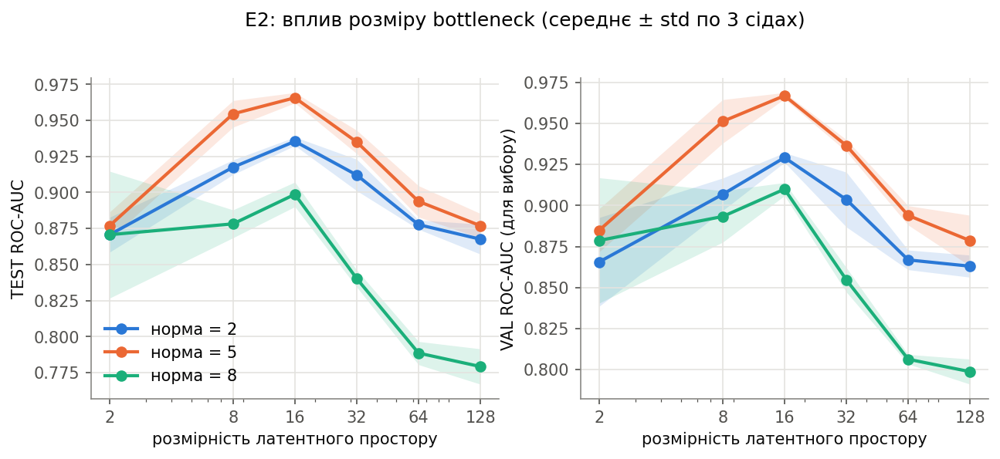
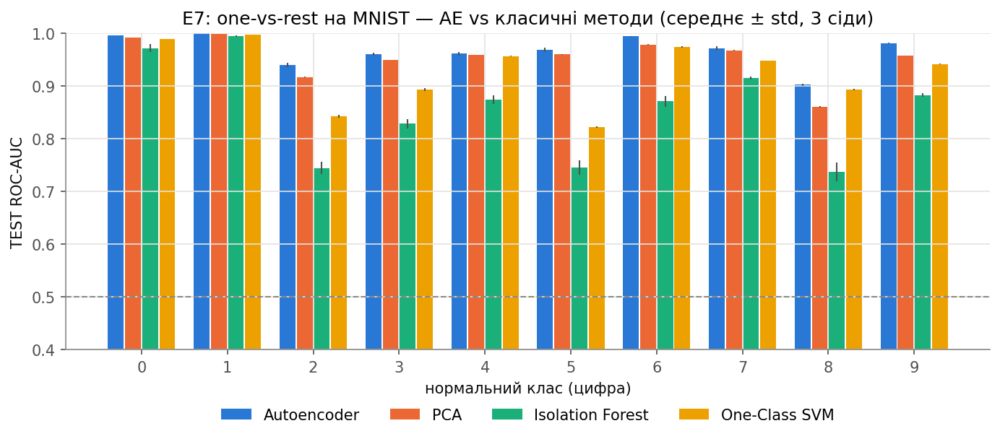

# Виявлення аномальних даних за допомогою автоенкодера — короткий технічний звіт

## 1. Постановка

Автоенкодер навчається лише на нормальних даних, оцінкою аномальності слугує помилка
реконструкції $s(x) = \frac{1}{784}\lVert x - \hat{x} \rVert_2^2$. Зразок вважається аномалією,
коли $s(x) > \tau$.

**Дані.** MNIST, протокол one-vs-rest: одна цифра — норма, решта дев'ять — аномалії.

| Вибірка | Склад | Для чого |
|---|---|---|
| train | 90 % нормальних з MNIST-train (≈5 400) | навчання AE і бейзлайнів |
| val | 10 % нормальних з MNIST-train + стільки ж аномалій з MNIST-train | рання зупинка, вибір гіперпараметрів, поріг τ |
| test | весь MNIST-test (≈10 % норма) | лише фінальна оцінка |

**Метрики.** ROC-AUC (головна), PR-AUC, а також Precision / Recall / F1 / FPR при порозі τ,
рівному 95-му перцентилю $s(x)$ на валідаційних нормальних зразках (цільовий FPR ≈ 5 %,
фактичний на тесті 5.3 ± 1.0 %).

## 2. Моделі

* **DenseAE**: 784 → 512 → 256 → latent → 256 → 512 → 784, ReLU, сигмоїда на виході.
* **ConvAE**: Conv(32, s2) → Conv(64, s2) → Linear(latent), дзеркальний декодер з ConvTranspose.
* **Бейзлайни**: PCA-реконструкція (16 компонент), Isolation Forest (200 дерев), One-Class SVM (RBF, ν = 0.1).
* Навчання: Adam, batch 128, до 40 епох, рання зупинка за val MSE з відновленням найкращих ваг.

Кожен прогін задається YAML-конфігурацією та сідом і зберігає `config.yaml`, `train.log`,
`history.csv`, `metrics.json`, `scores.npz`. Усього **489 прогонів**, зведення —
[results/experiments.csv](results/experiments.csv), таблиці — [reports/tables](reports/tables),
графіки — [reports/figures](reports/figures).

## 3. Протокол

1. Гіперпараметри (E1–E6, E8, E9) досліджено на нормальних класах {2, 5, 8} × 3 сіди,
   змінюючи один фактор від базової конфігурації (ConvAE, latent 32, MSE, lr 1e-3).
2. Фінальну конфігурацію обрано за найбільшим **val** ROC-AUC.
3. Фінальна оцінка (E7): 10 класів × 3 сіди, порівняння з бейзлайнами на однакових розбиттях,
   парний тест Вілкоксона по класах.

## 4. Результати гіперпараметричного аналізу (test ROC-AUC)

| Експеримент | Результат |
|---|---|
| E1. Архітектура | Dense 0.933 > Conv 0.896; Dense ще й стабільніший між сідами та швидший |
| E2. Розмір latent | 2: 0.873 · 8: 0.917 · **16: 0.933** · 32: 0.896 · 64: 0.853 · 128: 0.841 |
| E3. Denoising | σ ∈ {0, 0.1, 0.2, 0.4}: 0.896 / 0.895 / 0.896 / 0.900 — ефект у межах шуму |
| E4. Learning rate | 3e-4…3e-3 стабільно (≈0.895); 1e-2 нестабільно (0.852 ± 0.128) |
| E4. Функція втрат | MSE 0.896 ≈ BCE 0.891 > L1 0.845 |
| E5. Обсяг train | плато вже з ≈300–1000 нормальних зразків; 50 зразків — 0.844 |
| E6. Забруднення train | 0 %: 0.896 · 1 %: 0.856 · 5 %: 0.778 · 10 %: 0.726 · 20 %: 0.655 |
| E8. Рання зупинка | за val AUC +0.9…1.8 п.п., але потребує розмічених аномалій |
| E9. Достатність 40 епох | до плато val MSE ~86 епох, ROC-AUC 0.935 проти 0.936 за 40 епох |

Головне спостереження: val MSE на нормі монотонно падає зі зростанням latent, а якість
виявлення має форму перевернутої U — **мінімізація помилки реконструкції сама по собі не
оптимізує виявлення аномалій**.

## 5. Фінальна модель (E7)

DenseAE, latent 16, MSE, Adam lr 1e-3, batch 128, 40 епох, рання зупинка за val_loss.

| Метод | ROC-AUC | PR-AUC | F1 | Recall | FPR |
|---|---|---|---|---|---|
| **Autoencoder** | **0.967 ± 0.029** | **0.996** | **0.925** | **0.870** | 0.053 |
| PCA (16) | 0.954 ± 0.039 | 0.994 | 0.855 | 0.764 | 0.044 |
| One-Class SVM | 0.925 ± 0.058 | 0.990 | 0.783 | 0.677 | 0.049 |
| Isolation Forest | 0.856 ± 0.090 | 0.979 | 0.603 | 0.468 | 0.047 |

Середнє по 10 класах × 3 сіди. AE краще за кожен бейзлайн (Вілкоксон, p = 0.002), розкид між
сідами малий (std AUC ≈ 0.002).

## 6. Аналіз помилок і обмеження

* «Прості» аномалії з малою кількістю пікселів пропускаються: для норми = 8 цифра 1 виявляється
  лише в 1.4 % випадків. Хибно-позитивні — нетипові написання нормальної цифри.
* Метод дуже чутливий до забруднення навчальної вибірки (E6).
* Навчальний критерій (MSE) не збігається з цільовою метрикою, тож bottleneck доводиться обирати
  за розміченою валідацією.
* Бейзлайни налаштовано мінімально; MNIST простіший за реальні дані.

## 7. Висновки

1. Автоенкодер, навчений лише на нормі, досягає ROC-AUC 0.967 і F1 0.925 при FPR ≈ 5 % та
   статистично значуще перевершує PCA, One-Class SVM та Isolation Forest.
2. Найважливіший гіперпараметр — розмір bottleneck (оптимум 16).
3. Повнозв'язний AE кращий за згортковий; denoising і MSE/BCE майже не впливають на результат.
4. 40 епох достатньо: навчання до повної збіжності MSE якості не покращує.
5. Головні слабкості — чутливість до забруднення train і пропуск «простих» аномалій.
